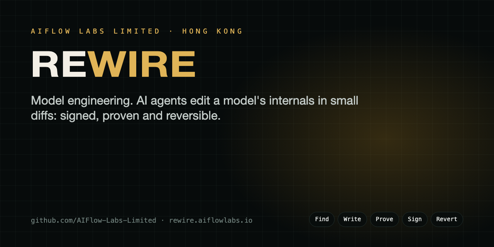

# REWIRE
**Model engineering: AI agents edit a model's internals, signed, proven and reversible.**

REWIRE is a workbench where AI agents change an open-weight language model by writing directly to its weights, in small diffs a person can audit. Every change is small, signed and reversible.

## How it works
Four parts, one loop: find the neuron, write the weight, prove the change.
1. **Scribe** — an AI agent with a sandbox and a budget of forward passes. It proposes an edit and writes exactly one diff file for one named target.
2. **Atlas** — a neuron-level map. The Scribe reads it to choose where to write; people read it to understand what the Scribe did.
3. **Implant** — the change itself: a sparse, signed, reversible diff that carries its intent, its acceptance tests and its inverse.
4. **Verdict** — the evaluation loop that scores the change and everything around it.

## Controls built into the design
Weight editing is dual use, so the controls are part of the product, not an add-on.
- **No self-targeting.** The editor model and the target model must differ.
- **Human gate.** An agent may propose and evaluate. Promoting an edit to a model people use needs a recorded human approval.
- **Signed provenance.** Every Implant carries its manifest, reasoning log and inverse diff.
- **Bit-exact revert.** Reverting an edit and matching the original weights exactly is a test that must pass, not a promise.
- **Audit mode.** The Atlas is designed to flag third-party diffs that weaken a model's safeguards.

## What we do not claim
That edits add capability, that editing replaces fine-tuning, or that a signed edit is a safe edit.

## Status
Research programme, planning stage. The next step is to reproduce a published third-party result in our own test setup. No code has been released and no results of our own are claimed.

👉 [rewire.aiflowlabs.io](https://rewire.aiflowlabs.io)

AIFLOW LABS products → [IRONWARD](https://github.com/AIFlow-Labs-Limited/ironward) · [IRONWARD-WEB](https://github.com/AIFlow-Labs-Limited/ironward-web) · [IRONWARD-WEB3](https://github.com/AIFlow-Labs-Limited/ironward-web3) · **REWIRE** · [IMPERA](https://github.com/AIFlow-Labs-Limited/impera)

---
**AIFLOW LABS LIMITED** · Hong Kong company, registered office in Sheung Wan · Company No. 78586258
[aiflowlabs.io](https://aiflowlabs.io) · ilessio@aiflowlabs.io

This repository holds programme information only. No code has been released.
